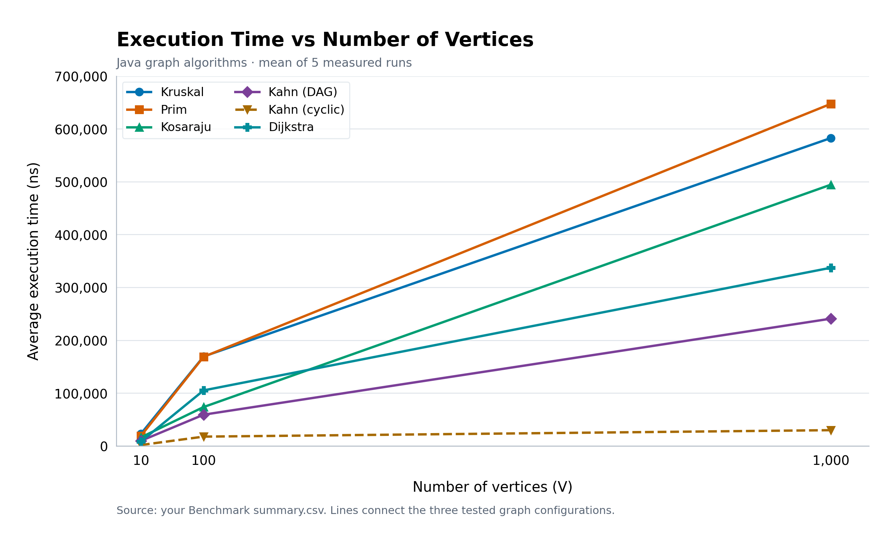
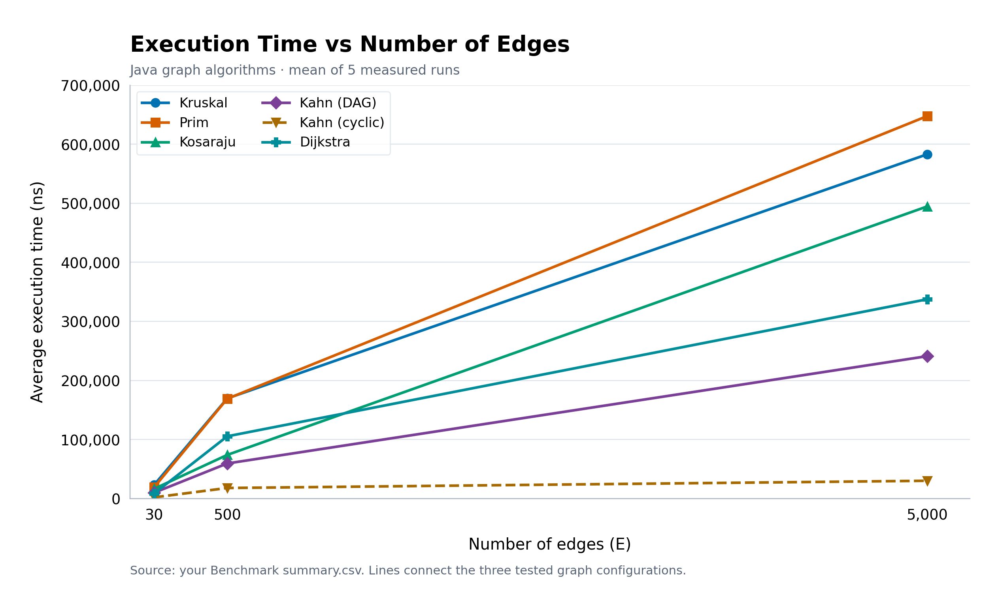

# Assignment 3: Smart City Infrastructure and Route Planning

**Student:** Ismail Shargazin  
**Group:** SE-2529

## 1. Overview

This project is a Java application that represents a city's infrastructure as a weighted graph.

- Vertices represent city districts or locations.
- Edges represent roads or infrastructure connections.
- Weights represent construction costs or travel distances.

The application uses a simplified city model with sample data. It does not represent a real city's roads or distances.

The main tasks are:

1. Find a minimum-cost network connecting all districts.
2. Analyze connectivity in directed graphs.
3. Find shortest routes from a selected district.
4. Compare algorithm performance on different graph sizes.

## 2. Implementation

### Graph representation

The graph uses an adjacency list and an edge list.

The adjacency list stores outgoing edges for each vertex. Prim, Kosaraju, Kahn and Dijkstra use this representation.

The edge list stores each added road once. Kruskal uses it to sort roads by weight.

For an undirected road, the adjacency list stores both directions. Therefore, an undirected graph with E roads has 2E adjacency entries.

Vertices are numbered from 0 to V - 1. The graph supports directed and undirected connections.

Weights are stored as integers. MST totals and shortest distances use `long` to avoid integer overflow when adding weights.

### Disjoint Set Union

The DSU structure implements:

- `find`: returns the root of a vertex's set.
- `union`: joins two different sets.
- Path compression: makes vertices point directly to their root.
- Union by rank: attaches the lower-rank tree below the higher-rank tree.

Kruskal uses DSU to check whether adding an edge would create a cycle.

### Kruskal's algorithm

Kruskal sorts all edges by increasing weight.

For each edge, it tries to merge the sets of its endpoints. If the sets are different, the edge is added to the result.

The algorithm stops after selecting V - 1 edges or examining all available edges.

### Prim's algorithm

Prim starts from a vertex and grows a tree using a minimum priority queue.

It selects the cheapest candidate edge leading to an unvisited vertex. Entries leading to already visited vertices are skipped.

For disconnected graphs, Prim restarts from an unvisited vertex.

Both Kruskal and Prim return a minimum spanning forest when the graph is disconnected. The result includes the number of components and a connectivity flag.

### Topological ordering

The application uses Kahn's algorithm.

It calculates each vertex's indegree and puts zero-indegree vertices into a queue. After processing a vertex, it decreases the indegrees of its outgoing neighbors.

If the algorithm processes all V vertices, it returns a valid topological order. Otherwise, the graph contains a cycle.

A partial order returned for a cyclic graph is not a valid full topological order.

### Strongly connected components

Kosaraju's algorithm finds the SCCs of a directed graph:

1. Run DFS and record vertices in finish order.
2. Reverse every edge.
3. Run DFS on the reversed graph in decreasing finish order.

Each traversal in the second pass produces one SCC.

Recursive DFS is used to keep the implementation straightforward.

### Dijkstra's algorithm

Dijkstra calculates shortest distances from a selected source using a minimum priority queue.

When a shorter route is found, the distance and predecessor are updated. A new queue entry is added, and outdated entries are skipped later.

The predecessor array is used to reconstruct routes.

Unreachable vertices keep `Long.MAX_VALUE`, and their paths are empty.

The implementation rejects negative edge weights. Dijkstra's usual greedy argument depends on non-negative weights: a later edge must not improve a distance that has already been considered final.

For example, with S→A = 1, S→B = 2 and B→A = -3, the shortest distance to A is -1. A standard Dijkstra implementation that finalizes vertices could incorrectly finalize A at 1.

## 3. Complexity Analysis

The input graph requires O(V + E) memory.

The extra-space bounds below include algorithm state and returned results, but exclude the input graph.

Java's `PriorityQueue` is a binary heap. Prim and Dijkstra use lazy queue entries instead of an indexed decrease-key operation.

| Algorithm | Time complexity | Extra space |
|---|---|---|
| DSU initialization | O(V) | O(V) |
| DSU find and union | Amortized O(α(V)) per operation | O(1) per iterative operation, using the O(V) DSU |
| Kruskal | O(V + E log(E + 1) + E α(V)) | O(V + E) |
| Prim with a lazy binary heap | O(V + E log(E + 1)) | O(V + E) |
| Kosaraju | O(V + E) | O(V + E) |
| Kahn | O(V + E) | O(V) |
| Dijkstra with a lazy binary heap | O(V + E log(E + 1)) | O(V + E) |

For connected simple undirected graphs, Prim's bound is commonly written as O(E log V), because log E is O(log V).

For simple graphs, Dijkstra also has the familiar bound O((V + E) log V).

The explicit lazy-heap bounds account for queues that can contain O(E) entries.

More vertices increase the size of arrays and the number of vertices to process. More edges increase sorting, adjacency scanning and possible heap operations.

Kosaraju and Kahn have linear complexity because their work is proportional to the vertices and edges examined.

Without DSU heuristics, parent chains can become long. Union by rank keeps trees shallow, while path compression shortens later searches. Together, they provide the amortized inverse-Ackermann bound.

Reconstructing a shortest path containing L vertices takes O(L) time and space.

## 4. Experimental Setup

Experiments used the following configurations:

| Configuration | Vertices | Edges |
|---|---:|---:|
| Small | 10 | 30 |
| Medium | 100 | 500 |
| Large | 1000 | 5000 |

The reported experiments were run on macOS using JDK 25.

The base random seed was `20261020`.

For each graph size:

- Undirected graph seed: base seed + V.
- DAG seed: base seed + V + 1.
- Cyclic directed graph seed: base seed + V + 2.

Weights were generated from 1 to 100. Duplicate weights were allowed. The generated graphs did not contain self-loops or parallel edges.

### Undirected graphs

A spanning tree was generated first by connecting each new vertex to a random earlier vertex.

Additional distinct roads were then added until the required edge count was reached. This guaranteed connectivity for MST experiments.

### Directed acyclic graphs

The generator shuffled the vertices and added edges only from earlier to later positions in that order.

This guaranteed that the generated graph was a DAG.

### Directed graphs with cycles

The generator first added the cycle:

`0 → 1 → 2 → 0`

It then added random distinct directed edges until the required edge count was reached.

These graphs were guaranteed to contain a cycle. They were not guaranteed to be strongly connected.

Kosaraju and Dijkstra used these directed cyclic graphs. Dijkstra used source vertex 0.

### Measurement procedure

Each case had 20 unmeasured warmup calls followed by 5 measured runs.

The same generated graph was reused, with fresh algorithm state and counters for each run.

Execution time was measured using `System.nanoTime()`.

Average time was calculated as:

`Average time = total time of five measured runs / 5`

The measured region included algorithm execution, internal allocations, operation counters and the small result returned by the benchmark method.

Graph generation and file output were outside the measured region.

The files contain:

- `raw_runs.csv`: individual measured runs.
- `summary.csv`: average times and operation counts.
- `environment.txt`: runtime information and experiment settings.

The fixed seeds reproduce graph inputs. Exact execution times can change between runs.

### Operation counters

- `edge_examinations`: edge entries inspected.
- `comparisons`: sorting comparator calls, heap comparator calls, and Dijkstra distance comparisons.
- `queue_operations`: queue insertions and removals.
- `find_calls`: DSU find invocations.
- `parent_traversals`: parent links followed during root search and compression.
- `union_calls`: attempted DSU unions.

These counters do not count every statement or branch. A zero means that the corresponding counter was not used for that algorithm.

## 5. Results

### Average execution time

All times below are in nanoseconds and are averages of five measured runs.

| Algorithm | V=10, E=30 | V=100, E=500 | V=1000, E=5000 |
|---|---:|---:|---:|
| Kruskal | 23083.20 | 169533.20 | 582891.60 |
| Prim | 19099.80 | 168958.40 | 647558.40 |
| Kosaraju | 16433.40 | 73883.20 | 494600.00 |
| Kahn: DAG | 9892.00 | 59408.20 | 241083.40 |
| Kahn: cyclic | 2016.60 | 17899.60 | 30108.40 |
| Dijkstra | 8491.60 | 105383.40 | 337433.20 |

### Kruskal and Prim operation counts

Counts are averages per run.

| Algorithm | V | Edges examined | Comparisons | Queue operations | Find calls | Parent traversals | Union calls |
|---|---:|---:|---:|---:|---:|---:|---:|
| Kruskal | 10 | 22 | 109 | 0 | 44 | 62 | 22 |
| Prim | 10 | 60 | 204 | 60 | 0 | 0 | 0 |
| Kruskal | 100 | 258 | 3863 | 0 | 516 | 890 | 258 |
| Prim | 100 | 1000 | 7620 | 1000 | 0 | 0 | 0 |
| Kruskal | 1000 | 2961 | 50352 | 0 | 5922 | 10872 | 2961 |
| Prim | 1000 | 10000 | 110824 | 10000 | 0 | 0 | 0 |

### Connectivity operation counts

| Algorithm | V | Edges examined | Queue operations |
|---|---:|---:|---:|
| Kosaraju | 10 | 90 | 0 |
| Kosaraju | 100 | 1500 | 0 |
| Kosaraju | 1000 | 15000 | 0 |
| Kahn: DAG | 10 | 60 | 20 |
| Kahn: DAG | 100 | 1000 | 200 |
| Kahn: DAG | 1000 | 10000 | 2000 |
| Kahn: cyclic | 10 | 30 | 0 |
| Kahn: cyclic | 100 | 500 | 0 |
| Kahn: cyclic | 1000 | 5055 | 20 |

Kosaraju uses recursive DFS, so queue operations are not counted.

### Dijkstra operation counts

| V | Edges examined | Comparisons | Queue operations |
|---|---:|---:|---:|
| 10 | 60 | 55 | 22 |
| 100 | 1000 | 1994 | 290 |
| 1000 | 9945 | 28918 | 2868 |

Dijkstra's edge count includes the initial negative-weight validation scan.

### Execution time vs number of vertices



### Execution time vs number of edges



The plots show the same three configurations. V and E increase together, so these experiments do not isolate their independent effects.

## 6. Comparison and Discussion

### Kruskal vs Prim

Both algorithms returned the same MST weights:

| V | Kruskal weight | Prim weight |
|---|---:|---:|
| 10 | 215 | 215 |
| 100 | 1233 | 1233 |
| 1000 | 12279 | 12279 |

Prim had the lower average time for the small and medium graphs. The medium results were very close. Kruskal had the lower average time for the large graph.

Kruskal sorts every edge, but it can stop examining sorted edges after accepting V - 1 edges.

Prim examines both adjacency directions of every road and performs priority queue operations.

The results do not show that one algorithm is always faster. These graphs are relatively sparse, and performance also depends on graph structure and implementation details.

### DSU

Each attempted union calls find twice. This explains why the find-call count is twice the union-call count.

Path compression and union by rank reduce the work needed to follow parent links.

The project explains their theoretical benefit, but does not measure a separate naive DSU implementation.

### SCC

Kosaraju examined exactly 3E entries:

- E during the first DFS.
- E while reversing the graph.
- E during the second DFS.

Its execution time increased as the graph grew, consistent with increasing linear work.

The cyclic graphs had 1, 1 and 14 SCCs for the small, medium and large configurations respectively. A graph containing a cycle does not necessarily form one SCC.

### Topological ordering

Kahn returned complete orders for the DAGs and detected cycles in all cyclic cases.

Cyclic runs were faster because fewer vertices entered the queue. The algorithm still examined every edge when calculating initial indegrees.

Detecting a cycle is a valid result; it does not produce a full topological order.

### Dijkstra

Dijkstra's execution time and operation counts increased with graph size.

Its work depends on reachable vertices, examined roads and successful distance improvements.

In the large graph, it examined 9945 entries: 5000 during weight validation and 4945 while processing reachable outgoing edges.

### Measurement limitations

The measurements include counter increments and allocation costs.

JVM compilation, caching and system activity can affect short runs. Five measurements per case provide a small experimental sample.

The observed results should therefore be interpreted together with theoretical complexity.

## 7. Testing

The `AlgorithmTests` class completed all 10 test groups successfully.

| Test group | What was checked |
|---|---|
| DSU | Joining sets, finding roots, repeated unions and component counts |
| Small graph MST | Both algorithms returned the expected weight of 10 |
| Disconnected graph | Correct forest weight and component count; unreachable paths were empty |
| Multiple MSTs | Equal weights and several valid MSTs with the same optimal weight |
| Topological ordering | Every edge pointed forward in the order; an added cycle was detected |
| SCC | Expected components; every vertex appeared exactly once |
| Dijkstra | Expected distances and route, zero weights and directed roads |
| Single vertex | Zero MST weight, zero source distance and correct SCC; self-loop detection |
| Negative weights | MST accepted negative weights; Dijkstra rejected them |
| Generated graphs | Required graph sizes, reproducible inputs, connected MST graphs, DAGs and cycles |

The final test output was:

```text
ALL TESTS PASSED (10 groups)
```

The `Main` demonstration also completed successfully:

- Kruskal and Prim returned MST weight 10.
- Dijkstra returned distances 0, 3, 2, 8 and 10.
- Kahn produced a valid DAG order and detected an added cycle.
- Kosaraju identified the expected SCCs.
- The disconnected example reported two components and an unreachable vertex.

## 8. How to Run

The source code is compatible with Java 17 or newer. The reported experiments used JDK 25.

No external Java libraries are required.

### IntelliJ IDEA

1. Open the project.
2. Select JDK 17 or newer.
3. Mark `src` as the Sources Root if necessary.
4. Run `AlgorithmTests`.
5. Run `Main`.
6. Run `Benchmark`.

Set Benchmark's working directory to the project root so that results are saved in `results/tables`.

### Terminal on macOS or Linux

Run these commands from the project root:

```bash
mkdir -p out
find src -name '*.java' -print > sources.txt
javac --release 17 -d out @sources.txt

java -cp out AlgorithmTests
java -cp out Main
java -cp out Benchmark
```

The benchmark regenerates the CSV files.

To regenerate the charts, use `summary.csv`:

- Plot V against `average_ns` for the vertices chart.
- Plot E against `average_ns` for the edges chart.
- Use a separate series for each algorithm or Kahn variant.
- Save the images in `results/plots`.

## 9. Conclusion

The application implements all required graph algorithms.

Kruskal and Prim find a minimum-cost infrastructure network. DSU supports efficient connectivity checks for Kruskal.

Kosaraju finds mutually reachable groups in directed networks. Kahn provides a dependency order for DAGs and detects cycles.

Dijkstra finds shortest routes with non-negative weights and handles unreachable districts.

Testing confirmed the expected results for the selected cases. The experiments showed increasing execution time and operation counts as graph sizes grew.

The appropriate algorithm depends on the task and graph representation. MST algorithms plan connections, SCC algorithms analyze directed connectivity, topological sorting orders dependencies, and Dijkstra calculates shortest routes.

## References

- Assignment 3: Smart City Infrastructure and Route Planning.
- Lecture 6: Disjoint Sets and MST.
- Lecture 7: SCC and Topological Ordering; Shortest Paths in DAGs.